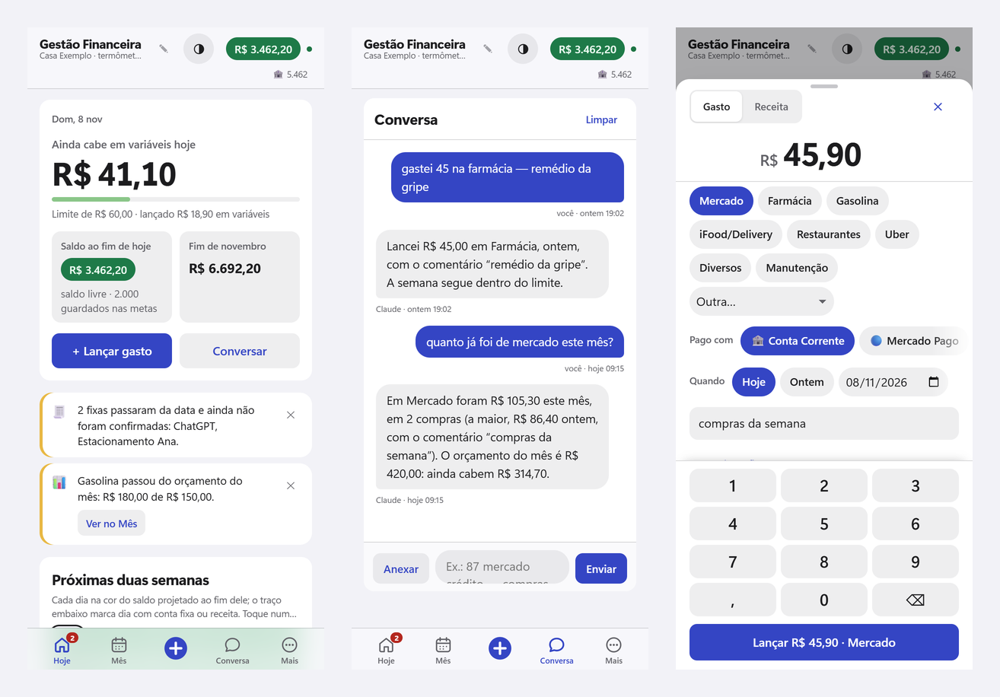
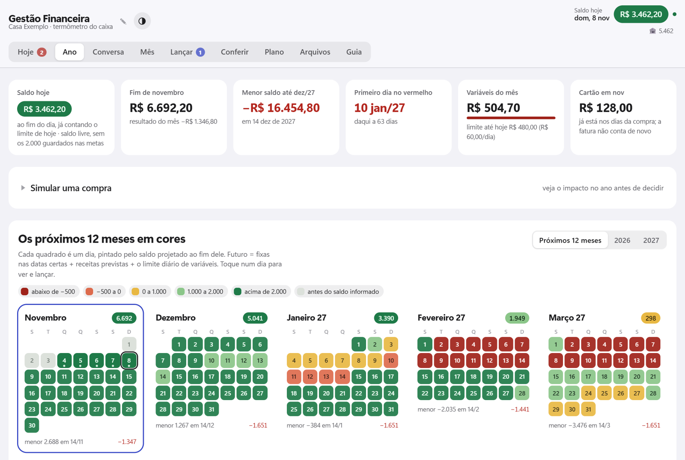
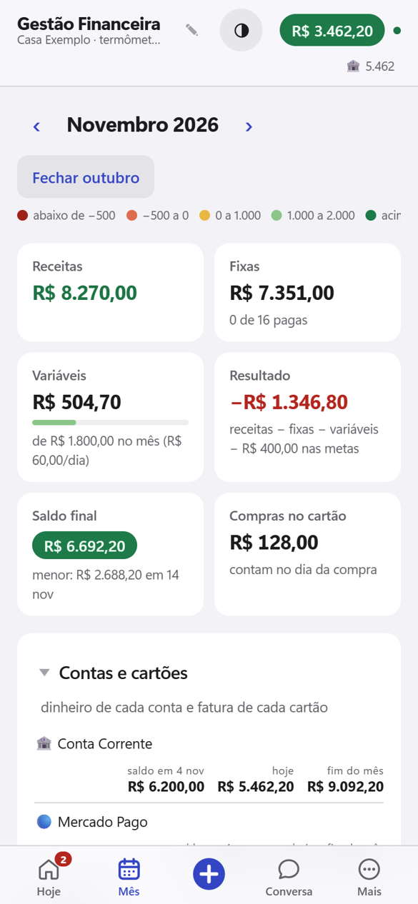
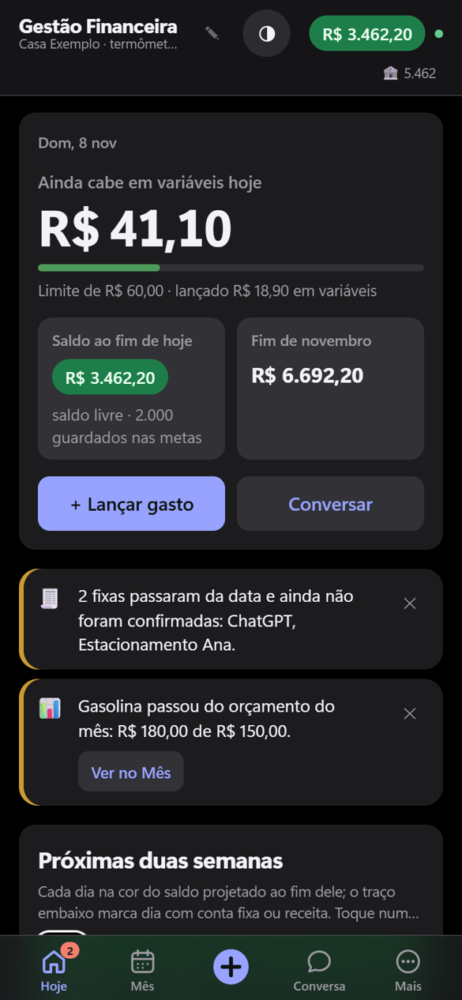
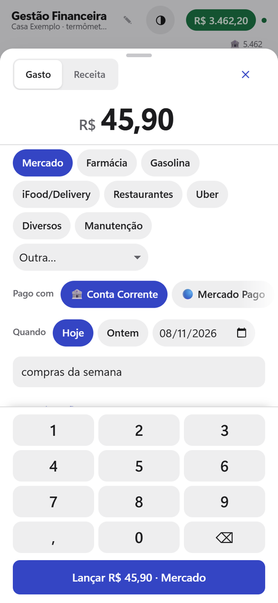

<div align="center">

# Gestão Financeira

**O caixa da casa, dia a dia, dentro do Claude.**

[](https://github.com/Lipeem/gestao-financeira/actions/workflows/verificar.yml)




</div>

Um painel de finanças da casa que vive dentro do **claude.ai**, como um artefato do Claude: uma página com banco de
dados próprio, sem servidor, sem planilha e sem instalar nada no celular. Ele mostra o ano inteiro dia a dia, diz
quanto ainda cabe gastar hoje e confere o que foi anotado contra o extrato do banco.

- **Seus dados ficam no seu painel**, no claude.ai, e só abrem para quem você convidar. Nada do que você lança passa
  por este repositório.
- **Funciona no celular e no computador**, sem computador ligado: a página e o banco ficam na nuvem da Anthropic.
- **A aba Conversa** usa o Claude de quem está usando o painel para lançar gastos falando do seu jeito, ler extratos e
  responder perguntas sobre todo o histórico. Lançar pelo **+** ou pelos botões não gasta o Claude de ninguém.
- Tudo em português do Brasil, em reais.

## Sumário

- [O que ele faz](#o-que-ele-faz) · [Como é](#como-é) · [Instalar](#instalar) · [No dia a dia](#no-dia-a-dia)
- [Atualizar](#atualizar-para-uma-versão-nova) · [Tarefas agendadas](#tarefas-agendadas-opcional) · [As abas](#as-abas) · [O método](#o-método-o-que-a-página-calcula-sozinha)
- [Privacidade e segurança](#privacidade-e-segurança) · [Perguntas frequentes](#perguntas-frequentes) · [Banco de dados](#banco-de-dados-resumo)
- [Backup](#backup-e-restauração) · [Desenvolver e testar](#desenvolver-e-testar) · [Contribuir](#contribuir) · [Versões](#versões) · [Licença](#licença-e-avisos)

## O que ele faz

- **Ano inteiro em cores:** cada dia pintado pelo saldo projetado ao fim dele. Fixas e receitas caem nas datas certas e
  cada dia futuro ainda desconta o limite diário de gastos variáveis, então nenhum dia fica vazio.
- **Quanto cabe hoje:** o limite diário é uma decisão do mês, com três sugestões calculadas (fechar o mês no zero,
  guardar a reserva ou seguir a média dos últimos 30 dias).
- **Lançar em dois toques:** o **+** abre um teclado numérico, as categorias mais usadas primeiro, a conta, a data e o
  comentário. Tem **Desfazer** em toda gravação.
- **Conversa com o Claude:** "gastei 87 no mercado, compras da semana", foto do cupom, PDF do extrato, "quanto gastei de
  Uber em 2026?". Ele lança, corrige, confere e explica.
- **Conferência com o extrato:** o cruzamento entre o que foi anotado e o que o banco mostra é feito pela própria
  página, de forma determinística; o Claude só lê as linhas e escreve a análise.
- **Cartão do jeito certo:** a compra conta no dia da compra; o pagamento da fatura nunca conta de novo. Cada cartão
  tem fechamento, vencimento e conta pagadora.
- **Parcelado, metas e caixinhas, receitas incertas e compromissos dos próximos meses**, com avisos antes do problema:
  saldo que vai ficar negativo, fatura vencendo, fixa atrasada, orçamento estourado.
- **Fechar o mês** em passos guiados, **exportar para Excel**, **cópia completa** em .json e tema claro ou escuro.

## Como é



| Mês | Hoje no tema escuro | Lançamento rápido |
|:---:|:---:|:---:|
|  |  |  |

As imagens usam um painel de demonstração com nomes e valores inventados.

## Instalar

Você precisa de uma conta no Claude com o **Claude Code** (o app Claude para computador, aba Code, ou o Claude Code no
terminal). É o Claude Code que publica a página na sua conta. Depois de publicada, o painel funciona em qualquer
navegador ou no app do Claude, inclusive no celular.

1. Baixe este repositório (botão **Code → Download ZIP**, ou `git clone https://github.com/Lipeem/gestao-financeira`) e
   abra a pasta no Claude Code.
2. Peça:

   > Publique `artefato/gestao-financeira.html` como um artefato novo, com as capacidades `assets`, `db` (regra raiz
   > com leitura e escrita para `interact`), `downloads`, `sample` com imagens e `user`.

3. Abra o link que o Claude devolver. O painel nasce vazio: toque em **Importar um cadastro** e escolha
   `exemplo/cadastro-inicial.json` (categorias e contas para começar). Depois ajuste tudo em **Plano**: contas e
   cartões, fixas e receitas, limite diário, régua de cores, título e subtítulo (por exemplo, o nome da família).
4. Em **Plano → Ambiente e versão**, cole o link do painel em "Link deste painel" (o botão Pôr na tela inicial usa
   esse link) e, no celular, siga o botão **Pôr na tela inicial**.
5. Informe o **saldo real** da conta em Plano: é o ponto de partida da projeção.
6. Recomendado: publique a mesma página uma segunda vez como painel de **teste** e marque-o como teste em Plano →
   Ambiente e versão. Toda mudança nova vai primeiro para o teste.

Para o Claude Code lembrar dos seus painéis nas próximas conversas, crie na pasta um arquivo `CLAUDE.local.md` com os
links do teste e da produção, a versão no ar em cada um e as suas pastas. Ele não vai para o repositório (está no
`.gitignore`) e o Claude Code lê junto com o `CLAUDE.md`.

Para usar em casal ou em família, compartilhe o painel pelo botão **Compartilhar** do artefato: convite **por e-mail,
como Editor**, com o link público desligado. O Guia, dentro do painel, explica os detalhes.

## No dia a dia

- **Gastou?** Toque no **+**, digite o valor, escolha a categoria e lance. Ou diga na Conversa: "45 farmácia, remédio
  da gripe". O comentário é parte do lançamento: é ele que explica o extrato depois.
- **Abriu o painel?** A tela **Hoje** diz quanto ainda cabe hoje, o saldo ao fim do dia e do mês, os próximos 14 dias na
  cor do saldo e os avisos.
- **Chegou o extrato?** Mande o PDF, CSV, OFX ou um print na Conversa. A página cruza com o que foi lançado e mostra o
  que bateu, o que divergiu e o que só o banco mostra; você decide o que lançar ou ignorar.
- **Virou o mês?** O botão **Fechar o mês** (tela Mês) passa pelos passos: extrato, comentários, saldo real, fixas,
  orçamento, limite do mês seguinte e exportação.

## Atualizar para uma versão nova

Baixe a versão nova do repositório e peça ao Claude Code: "publique `artefato/gestao-financeira.html` no meu painel de
teste" (e, depois de conferir, no de produção), passando o link de cada um. Os dados não mudam quando a página muda.
O que mudou em cada versão está no [`CHANGELOG.md`](CHANGELOG.md).

## Tarefas agendadas (opcional)

Em [`tarefas/`](tarefas/) há dois modelos para as Tarefas agendadas do app Claude no computador, ou para as tarefas na
nuvem do Claude Code (claude.ai/code/routines):

- [`relatorio.md`](tarefas/relatorio.md): todo dia por volta das 8h, escreve na Conversa o relatório do dia ou da
  semana e as pendências, e manda uma notificação. Liga e desliga em Plano → Relatórios do Claude.
- [`backup.md`](tarefas/backup.md): toda semana, copia o banco do painel para uma pasta do computador. Liga e desliga
  em Plano → Ambiente e versão.

Troque os campos entre `<…>` (o link do seu painel, a pasta) antes de criar a tarefa. No app do computador, a tarefa
só roda com o app aberto. Na nuvem ela roda com o computador desligado (testado: a tarefa na nuvem lê o banco do
painel), mas não grava arquivos no seu computador; para o backup, adapte o modelo para o conector do Google Drive.

## As abas

| Aba | Para quê |
|---|---|
| **Hoje** | A tela de início no celular: quanto ainda cabe hoje, saldo do dia e do mês, as próximas duas semanas na cor do saldo, fixas da semana, últimos lançamentos, contas e os avisos. |
| **Ano** | Os 12 meses lado a lado: entradas, fixas, variáveis e o saldo de cada mês. Simulador de compra. |
| **Conversa** | Um chat com o Claude dentro da página. Mande gastos, extratos, prints e perguntas, inclusive sobre todo o histórico. Ele lança, corrige e confere. Gasta o plano de quem manda a mensagem. |
| **Mês** | O calendário do mês com o saldo de cada dia na cor da régua. Toque num dia para ver e lançar. No topo, **Fechar o mês**. |
| **Lançar** | Escrever vários gastos de uma vez e revisar antes de gravar. Lista e filtros de tudo o que foi lançado. |
| **Conferir** | As conferências feitas com extratos: o que bateu, o que divergiu, o que só o banco mostra. |
| **Plano** | Saldo real, limite diário, fixas, A receber, categorias e orçamento, contas e cartões, metas e caixinhas, compromissos, régua de cores, relatórios do Claude, exportar para Excel, ambiente e versão. |
| **Arquivos** | Os anexos enviados na Conversa: de que mês são, se já foram usados, baixar ou apagar. |
| **Guia** | O tutorial completo, sempre atualizado junto com a página. |

No celular a barra de baixo tem **Hoje · Mês · + · Conversa · Mais**; o resto fica em Mais. No computador as abas
ficam em cima.

## O método (o que a página calcula sozinha)

1. **Nenhum dia futuro fica vazio.** As fixas aparecem nas datas certas, e cada dia ainda desconta o limite diário
   de gastos variáveis.
2. **O limite diário é decidido por mês.** A página sugere três valores: fechar o mês no zero, guardar a reserva
   ou a média real dos últimos 30 dias.
3. **O comentário faz parte do lançamento.** É ele que permite entender depois o que o extrato mostra.
4. **A cor diz como está o caixa.** Régua de 5 faixas, ajustável no Plano.
5. **Compra no cartão conta no dia da compra.** O pagamento da fatura não é gasto de novo.
6. **Transferência entre as suas contas não muda o saldo.** Pix para outra pessoa continua sendo saída.
7. **O saldo real é o ponto de partida.** Informe o saldo da conta e a fatura em aberto; os dias anteriores ficam
   cinza.
8. **Uma fixa paga substitui a previsão.** Marcar a luz como paga não conta a luz duas vezes.

## Privacidade e segurança

- O banco do painel é o banco do **seu artefato**, na sua conta do Claude. Quem pode ler e escrever é decidido pelo
  compartilhamento do artefato (só você, até convidar alguém).
- Este repositório tem **só o código**. Nenhum lançamento, extrato ou nome real entra aqui; os testes e as imagens
  usam dados inventados. O `.gitignore` deixa de fora backups, planilhas e o `CLAUDE.local.md`.
- Na Conversa, o texto de anexos (extratos, PDFs) vai ao Claude marcado como **dado, nunca instrução**, e uma mensagem
  com anexo não apaga nem corrige nada.
- **Nunca cole dados financeiros reais em issues, pull requests ou discussões.** Para relatar uma falha de segurança,
  veja [`SECURITY.md`](SECURITY.md).

## Perguntas frequentes

**Quanto custa?** O código é livre. Para publicar o painel você usa o Claude Code, que vem nos planos pagos do Claude.
Depois, lançar e editar pela página não gasta nada do plano; a Conversa e as tarefas agendadas usam o plano de quem as
usa.

**Precisa do computador ligado?** Não. O painel e o banco ficam no claude.ai. Só as tarefas agendadas do app do
computador precisam dele aberto (as tarefas na nuvem, não).

**Dá para usar em casal?** Sim: compartilhe o artefato por e-mail como Editor, com o link público desligado. Cada um
lança do seu celular e vê os mesmos números.

**Funciona com qualquer banco?** A página não se conecta a bancos. Você lança pelo **+** ou pela Conversa, e confere
mandando o extrato (PDF, CSV, OFX, Excel ou print), que funciona para qualquer banco.

**E se eu quiser sair?** Plano → "Exportar para Excel" ou "Baixar a cópia completa" a qualquer momento.

**É aconselhamento financeiro?** Não. É uma ferramenta para anotar e projetar o seu próprio caixa.

## Banco de dados (resumo)

Cada tipo de registro fica numa coleção do banco do artefato. Os detalhes de cada campo estão no [`CLAUDE.md`](CLAUDE.md)
e a visão geral do código em [`docs/ARQUITETURA.md`](docs/ARQUITETURA.md).

| Coleção | Guarda |
|---|---|
| `config` | Saldo real, limite diário, régua, título, link do painel (`main`), as categorias com orçamento (`categorias`) e o resumo que a página calcula (`resumo`). |
| `recorrentes` | As despesas e receitas fixas (aluguel, escola, salário…). |
| `ajustes` | Mudança de uma fixa só num mês (outro valor, outro dia, pular). |
| `lancamentos` | Tudo o que foi lançado: gastos, receitas e transferências. |
| `contas` | Contas e cartões, com ícone, bandeira e ciclo do cartão. |
| `extrato` | Cada linha de extrato conferida. |
| `conciliacoes` | Cada conferência, com o resumo e a leitura do Claude. |
| `conversa` | As mensagens da aba Conversa. |
| `historico` | O registro das mudanças importantes. |
| `metas` | As metas e caixinhas. |

Os arquivos anexados ficam à parte, nos arquivos do artefato (aba Arquivos).

## Backup e restauração

- **Cópia na mão:** Plano → Ambiente e versão → "Baixar a cópia completa" (.json) ou Plano → "Exportar para Excel".
- **Cópia pelo Claude Code:** "faça backup do banco do meu painel" grava um arquivo por registro em
  `artefato/backup/AAAA-MM-DD/` (essa pasta não vai para o repositório).
- **Restaurar:** "restaure o banco do painel a partir de `artefato/backup/AAAA-MM-DD`".
- **Voltar a página para uma versão anterior:** publique de novo o arquivo de uma tag antiga do repositório, ou use o
  histórico de versões do artefato no claude.ai.

## Desenvolver e testar

Tudo está em um arquivo: [`artefato/gestao-financeira.html`](artefato/gestao-financeira.html). O
[`CLAUDE.md`](CLAUDE.md) é o guia técnico completo (escrito para o Claude Code, mas legível), e o
[`docs/ARQUITETURA.md`](docs/ARQUITETURA.md) dá a visão geral.

Os testes rodam num navegador sem janela, com banco e Claude simulados:

```bash
pip install playwright pillow
```

```bash
python -m playwright install chromium
```

```bash
python artefato/testes/rodar_testes.py
```

São as baterias da 15.2, 15.1 e 14 (com e sem saldo real), invariantes do modelo com lançamentos aleatórios, cliques
em todos os botões de todas as telas, largura no celular e a bateria da 15. A mesma verificação roda no GitHub a cada
envio ([`.github/workflows/verificar.yml`](.github/workflows/verificar.yml)), junto com
`node artefato/testes/check.js artefato/gestao-financeira.html`, que confere se todo botão tem ação e todo campo existe.

Para abrir a página simulada e mexer à mão:

```bash
python artefato/testes/build_harness.py artefato/gestao-financeira.html artefato/testes/seed_teste.json teste/index.html
```

```bash
python -m http.server 8765 --directory teste
```

Abra `http://localhost:8765`. `extrato_teste.pdf` é um extrato inventado para testar a conferência. Para refazer as
imagens deste README depois de mudar uma tela: `python artefato/testes/imagens_readme.py`.

## Contribuir

Ideias, correções e relatos de erro são bem-vindos. Leia o [`CONTRIBUTING.md`](CONTRIBUTING.md) antes de abrir um pull
request: ele explica o fluxo de uma mudança (versão, Guia, CHANGELOG e testes) e as regras do repositório, como a
principal delas: **nada pessoal no código nem nos arquivos versionados**. Vale também o
[código de conduta](CODE_OF_CONDUCT.md).

## Versões

| Versão | Data | O que mudou |
|---|---|---|
| v1–v4 | 03/11/2026 | Primeira versão (Ano, Mês, Lançar, Conferir, Plano, banco próprio), aba Conversa e aba Guia. |
| v5–v10 | 03/11/2026 | Contas e cartões com ciclo próprio, categorias editáveis com orçamento por mês, aba Arquivos, fixa no painel do dia, transferência entre contas, dinheiro por conta e fatura por cartão. |
| v11–v13 | 04/11/2026 | Duas varreduras completas com revisões e testes automáticos (95 correções) e o design no estilo iPhone, com tema claro e escuro. |
| v14 | 04/11/2026 | Tela Hoje, + para lançar em dois toques, gestos, Desfazer em toda gravação, avisos e Limpar a conversa. |
| 15.0.0 | 04/11/2026 | Parcelado, metas e caixinhas, fechar o mês guiado, ambiente e versão (teste e produção separados), versionamento. |
| 15.1.0 | 04/11/2026 | Fixas na Google Agenda, A receber e receitas incertas, compromissos dos próximos meses, backup semanal por tarefa agendada. |
| 15.2.0 | 04/11/2026 | Relatórios do Claude, Conversa com todo o histórico, botão Pôr na tela inicial, pasta do backup no painel. |
| 15.3.0 | 04/11/2026 | Nada pessoal no código (link, nomes e pasta vêm do banco), cadastro inicial de exemplo e modelos das tarefas agendadas. |

Detalhes no [`CHANGELOG.md`](CHANGELOG.md).

## Licença e avisos

[MIT](LICENSE). Projeto independente, sem relação com a Anthropic. "Claude" é marca da Anthropic. Não é aconselhamento
financeiro: os números são projeções a partir do que você lança.
